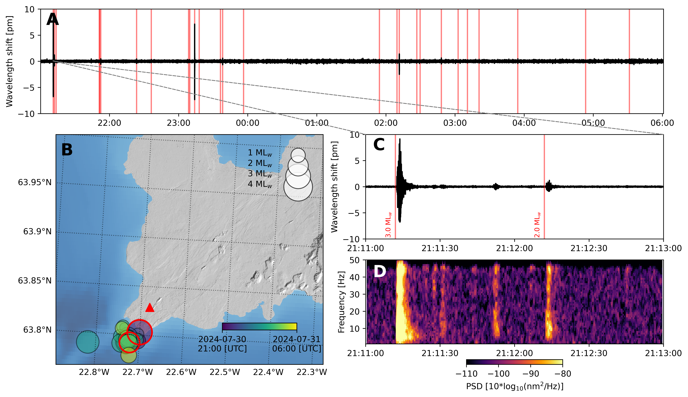

# OFS29

This repository contains the analysis material for the 29th Optical Fibre
Sensing Conference (OFS29) in Porto, Portugal. The notebooks focus on
Fiber Bragg Grating (FBG) accelerometer measurements collected during an experiment at the Royal Observatory of Belgium (ROB.ipynb) and at
Gunnuhver (Reykjanes Peninsula) where an earthquake sequence happened on 30–31 July 2024 (GUNN.ipynb & sensitivity_eq.ipynb).

## Repository contents

- `notebooks/GUNN.ipynb` — processing and visualization of the Gunnuhver FBG
  accelerometer recordings and earthquake catalogue.
- `notebooks/ROB.ipynb` — FBG data processing and comparison with a
  conventional seismometer.
- `notebooks/sensitivity_eq.ipynb` — comparison of FBG and broadband seismic
  sensors, including timing and sensitivity analysis.
- `map/` — map data and earthquake-related geographic resources used by the
  analyses.
- `data/` — information about the project data source.



## Data

The data used by the notebooks is available from
[Zenodo](https://doi.org/10.5281/zenodo.23891075). Download the required files
before running the notebooks and update any local file paths as needed.

## Running the analyses

Open the notebooks with Jupyter Notebook or JupyterLab, install the Python
packages imported by the notebook you want to run, and execute the cells in
order. The notebooks document the processing steps, filtering, comparison, and
visualization workflows.

## Cite

Please cite the [paper](https://doi.org/10.1117/12.3061572) associated to this code :

```
@inproceedings{govoorts2025seismic,
  title={Seismic activity monitoring in Iceland with fiber Bragg grating accelerometers},
  author={Govoorts, Julien and Caucheteurb, Christophe and Caudrona, Corentin and Lecocqc, Thomas},
  booktitle={Proc. of SPIE Vol},
  volume={13639},
  pages={1363998--1},
  year={2025}
}